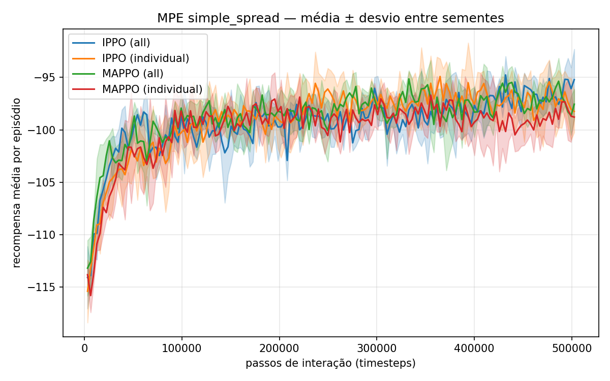

# Miniprojeto de IA — MARLlib: rede compartilhada × uma rede por agente

Miniprojeto da disciplina de Inteligência Artificial (UNICAP, 2026.2). Reproduzimos parte do benchmark do artigo da **MARLlib**, comparamos com os resultados publicados e avaliamos uma modificação que o artigo não mede: **treinar todos os agentes com uma rede neural compartilhada em vez de uma rede por agente**.

**Resultado em uma frase:** a rede compartilhada treina **~42% mais rápido** sem perder desempenho.

## Artigo base

Hu, S.; Zhong, Y.; Gao, M.; Wang, W.; Dong, H.; Liang, X.; Li, Z.; Chang, X.; Yang, Y.
**MARLlib: A Scalable and Efficient Library for Multi-agent Reinforcement Learning.**
*Journal of Machine Learning Research*, v. 24, n. 315, p. 1–23, 2023.
[PDF](https://jmlr.org/papers/volume24/23-0378/23-0378.pdf) · [Código](https://github.com/Replicable-MARL/MARLlib) · [Documentação](https://marllib.readthedocs.io/en/latest/)

Material de estudo completo (conceitos, artigo, aplicações, modificação, perguntas prováveis): [docs/Material_de_Estudo_MARLlib.pdf](docs/Material_de_Estudo_MARLlib.pdf).

## Resultados

Ambiente MPE `simple_spread` (3 agentes cobrindo 3 marcos), 500 mil passos por execução, 3 sementes, hiperparâmetros *finetuned* da própria MARLlib, só CPU (Windows 11, 6 núcleos).

| Algoritmo | Rede | Recompensa final (média ± desvio) | Tempo por execução | Artigo |
|---|---|---|---|---|
| IPPO | compartilhada | −96,4 ± 0,6 | 17,0 min | −65,74 |
| IPPO | uma por agente | −97,4 ± 2,1 | 28,7 min | — |
| MAPPO | compartilhada | −97,2 ± 0,8 | 17,8 min | −66,26 |
| MAPPO | uma por agente | −98,7 ± 1,5 | 30,5 min | — |



- **Reprodução:** IPPO e MAPPO empatam, como no artigo, mas ficam ~30 pontos abaixo dele. Com 2 milhões de passos (IPPO, 1 semente) chegamos a −87,5: treinar mais reduz a diferença, mas não a elimina ([curva](results/longo/curva_2M.png)).
- **Modificação:** rede compartilhada = ~42% menos tempo, recompensa igual ou levemente melhor e menor variação entre sementes.
- **Outro hardware:** o ganho de tempo se repete em outra máquina (benchmark de 100 mil passos, IPPO):

| Máquina | Compartilhada | Uma por agente | Ganho |
|---|---|---|---|
| Intel i5-9400F, 6 núcleos, Windows 11 (referência) | 3,49 min | 5,81 min | 40% |
| AMD Ryzen 3 3300X, 8 núcleos lógicos, Windows 10 ([pedro.md](results/benchmark/pedro.md)) | 3,97 min | 5,94 min | 33% |

**Vídeo:** [results/video/agentes_treinando.mp4](results/video/agentes_treinando.mp4) (32 s) mostra, lado a lado e com a mesma situação inicial, os agentes sem treino, após 160 mil passos e após 2 milhões de passos. Gerado com `python experiments/make_video.py` (precisa do `ffmpeg` no PATH ou na variável `FFMPEG`, e do treino de 2 milhões em `results/longo/`).

Dados: [results/resumo.md](results/resumo.md), [results/resumo_por_execucao.csv](results/resumo_por_execucao.csv) e curvas por execução em [results/curvas_dados/](results/curvas_dados/).

## Estrutura

```
├── MARLlib/            código oficial do artigo (submódulo git, commit 80e9973)
├── experiments/
│   ├── apply_patch.py  aplica as correções da MARLlib no RLlib instalado
│   ├── smoke_test.py   teste rápido da instalação (~1 min)
│   ├── benchmark.py    teste de tempo em outro hardware (~10 min)
│   ├── run.py          uma execução: --algo ippo|mappo|vdppo --share all|individual --seed N --steps N
│   ├── run_all.sh      as 12 execuções do projeto (~4h30)
│   ├── analyze.py      gera tabela, gráfico e curvas compactas
│   └── make_video.py   vídeo dos agentes antes/durante/depois do treino
├── results/            resumos, gráficos, curvas e benchmarks
├── docs/               enunciado, artigo e material de estudo
├── setup.ps1           instalação no Windows
└── setup.sh            instalação no Linux
```

## Instalação

A MARLlib só funciona com versões antigas (Python 3.8, Ray 1.8, PyTorch 1.9, gym 0.20). Os scripts de instalação montam tudo num ambiente virtual próprio (`.venv`), sem mexer no Python que você já tem. Não precisa de GPU.

**Requisitos:** Windows 10/11 ou Linux x86_64, [Git](https://git-scm.com/downloads), ~3 GB livres e internet. Mac com chip Apple (M1/M2/M3) **não é suportado** (o Ray 1.8 não tem versão para ele).

### Windows

Abra o **PowerShell** e rode:

```powershell
cd C:\
git clone --recursive https://github.com/heitorfariass/miniprojeto-ia-marllib.git
cd miniprojeto-ia-marllib
powershell -ExecutionPolicy Bypass -File setup.ps1
```

> Clone numa pasta **fora do OneDrive** e com caminho curto (ex.: `C:\miniprojeto-ia-marllib`). O OneDrive tenta sincronizar os milhares de arquivos do ambiente virtual, e caminhos muito longos podem quebrar o Ray.

A instalação leva ~10–15 min e baixa ~1 GB. O `uv` (gerenciador de Python) é instalado automaticamente se você não tiver.

### Linux

```bash
git clone --recursive https://github.com/heitorfariass/miniprojeto-ia-marllib.git
cd miniprojeto-ia-marllib
bash setup.sh
```

## Rodar

Ative o ambiente (sempre que abrir um terminal novo, dentro da pasta do repositório):

```powershell
.\.venv\Scripts\Activate.ps1      # Windows (PowerShell)
source .venv/bin/activate         # Linux
```

### 1. Teste da instalação (~1 min)

```bash
python experiments/smoke_test.py
```

Deve terminar com `SMOKE TEST OK`. No começo aparece uma tabela de ambientes com vários `Error`: é normal, só o MPE é instalado e só ele é usado.

### 2. Teste de tempo em outro hardware (~10 min, varia com o PC)

```bash
python experiments/benchmark.py --nome SEU_NOME
```

Treina o IPPO por 100 mil passos com rede compartilhada e depois com uma rede por agente, e grava `results/benchmark/SEU_NOME.md` com a sua máquina, os tempos, o ganho percentual e a comparação com o PC de referência (3,49 min × 5,81 min, ganho de 40%). Deixe o PC na tomada e evite usar programas pesados enquanto roda, porque isso distorce o tempo.

Para entregar o resultado: commit + push de `results/benchmark/SEU_NOME.md` (é preciso ser colaborador do repositório) ou envie o arquivo para o Heitor.

### 3. Reproduzir todos os experimentos (~4h30)

```bash
bash experiments/run_all.sh        # no Windows, use o Git Bash com o venv ativo
python experiments/analyze.py      # tabela, gráfico e curvas
```

Execuções já concluídas são puladas se o script for rodado de novo. Rode **uma execução por vez**: duas instâncias do Ray em paralelo colidem na inicialização no Windows.

### Problemas comuns

| Sintoma | Solução |
|---|---|
| `Activate.ps1 não pode ser carregado` | `Set-ExecutionPolicy -Scope CurrentUser RemoteSigned` e tente de novo |
| `uv` não encontrado logo após instalar | Feche e abra o PowerShell e rode `setup.ps1` de novo |
| Pasta `MARLlib/` vazia | `git submodule update --init` |
| `Failed to get gcs server address` | Outro treino ainda está rodando; espere terminar ou feche os processos `python`/`raylet` |
| `numpy.typing has no attribute NDArray` | `pip install pillow==9.5.0` |

## Detalhes do experimento

| Item | Valor |
|---|---|
| Ambiente | MPE `simple_spread` (PettingZoo 1.12): 3 agentes, 3 marcos, 25 passos por episódio, 5 ações discretas |
| Algoritmos | IPPO (aprendizado independente) e MAPPO (crítico centralizado) |
| Modificação | `share_policy="all"` (rede compartilhada) × `share_policy="individual"` (uma rede por agente) |
| Rede | MLP 128-256 |
| Hiperparâmetros | *finetuned* da MARLlib para MPE: lr 5e-4, clip 0,3, entropia 0,01, 10 épocas por lote, lote de 128 episódios |
| Orçamento | 500 mil passos por execução (e um teste de 2 milhões) |
| Avaliação | média da recompensa nos últimos 10% das iterações; média ± desvio entre 3 sementes |
